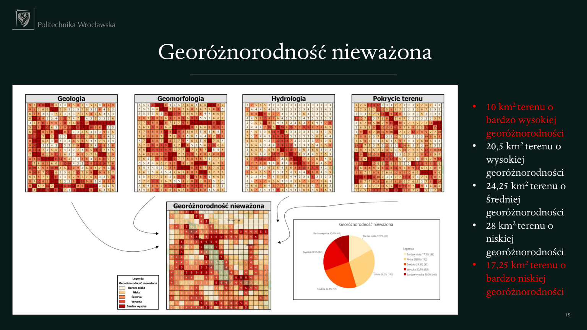
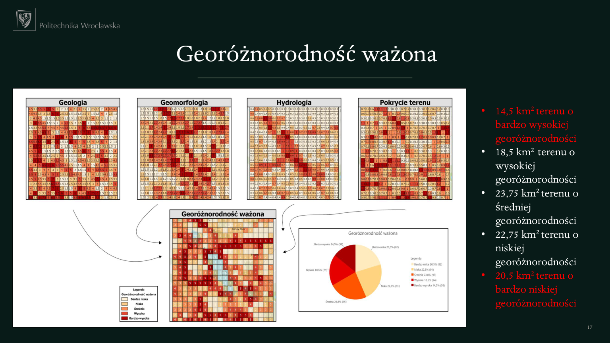
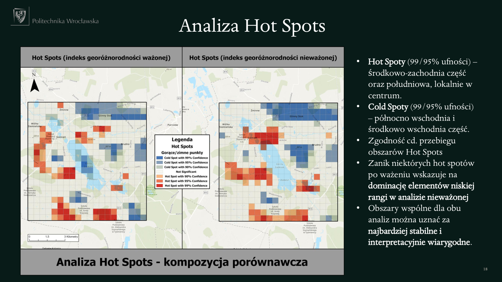
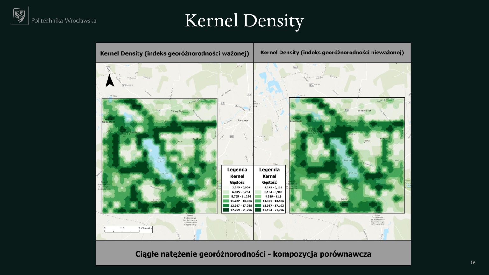

# Geodiversity Assessment of the Parczew Plain in ArcGIS Pro

**Author: Jakub Maciejak** · Academic GIS project · Wrocław University of Science and Technology

A spatial assessment of a **100 km² lowland study area** in the Parczew Plain, eastern Poland. The project combines geological, terrain, hydrological and land-cover information to map geodiversity and compare an unweighted assessment with an **Analytic Hierarchy Process (AHP)** weighted assessment.

The analysis was performed primarily in **ArcGIS Pro**. This repository presents the methodology, maps and findings as a GIS portfolio case study. It does not contain a Python application or an automated processing pipeline.

## Project objective

Identify spatial differences in geodiversity within an agricultural and forested landscape, and examine how prioritising different environmental components changes the resulting maps and spatial clusters.

The study area lies in Parczew County, Lublin Voivodeship, and includes the Siemień fish ponds and surrounding rural landscapes.

## Skills demonstrated

- Integrating vector and raster datasets from multiple environmental sources.
- Geological map digitisation, raster mosaicking and clipping to a study area.
- Comparing analytical grid sizes and calculating cell-level indicators.
- Assessing categorical diversity and terrain variability.
- Combining criteria through an unweighted index and AHP weighting.
- Comparing spatial clusters and communicating results through thematic maps.

## Data used

| Component | Dataset identified in the presentation | Preparation |
| --- | --- | --- |
| Geology | Detailed Geological Map of Poland, 1:50,000 (PIG) | Digitisation from a WMS map |
| Terrain | 1 m digital terrain model, GUGiK/Geoportal | Raster mosaic and clipping |
| Hydrology | BDOT10k, GUGiK/Geoportal | Extraction and clipping of rivers, lakes and wetlands |
| Land cover | CORINE Land Cover 2018 | Clipping to the study area |

These are the source descriptions recorded in the presentation, not a complete dataset manifest. Original input datasets are not bundled. The presentation labels the CLC source as “ESA”; its exact dataset attribution should be checked against the original download metadata before reuse.

## Methodology

### 1. Prepare a common study area

Environmental layers were prepared for a shared 100 km² extent. Geological units were digitised, the terrain model was mosaicked, and hydrology and land-cover data were clipped to the area of interest.

### 2. Compare analytical grids

Four cell sizes were assessed using the number of lithofacies categories per cell:

| Cell size | Minimum | Maximum | Mean |
| --- | ---: | ---: | ---: |
| 100 × 100 m | 0 | 7 | 1.53 |
| 250 × 250 m | 0 | 10 | 2.47 |
| **500 × 500 m** | **0** | **16** | **4.48** |
| 1,000 × 1,000 m | 2 | 28 | 10.21 |

The project selected **500 × 500 m** cells. The presentation describes this option as having a roughly normal distribution and a wider value range than the 250 m alternative. No formal normality-test output is included in the supplied materials.

### 3. Calculate component indicators

| Component | Indicators presented |
| --- | --- |
| Geological | Number of polygon units, number of categories, Shannon diversity index (SHDI) |
| Geomorphological | Elevation range, mean slope, Topographic Wetness Index (TWI) |
| Hydrological | River length, surface-water area, shoreline complexity labelled LSI |
| Landscape | Number of land-cover units, number of categories, SHDI |

The accompanying course instructions describe polygon overlays and spatial joins, zonal raster statistics, and SHDI calculation with the ZonalMetrics toolbox. They also describe rescaling indicators and classifying results. These instructions provide methodological context; they are not a saved execution log of this project.

### 4. Compare unweighted and weighted assessments

The presentation compares an unweighted composite assessment with AHP-derived weights:

| Component | Reported weight |
| --- | ---: |
| Geological | 0.54 |
| Geomorphological | 0.28 |
| Hydrological | 0.12 |
| Landscape | 0.06 |

The weighted assessment therefore gives the greatest influence to geological and terrain-related variation. It represents an alternative set of priorities, not independent proof that one assessment is more accurate.

### 5. Explore spatial patterns

Hot Spot maps and Kernel Density visualisations were compared between the two assessments. Exact neighbourhood settings, density bandwidths and all geoprocessing parameters are not included in the supplied presentation.

## Results

### Area in each geodiversity class

| Class | Unweighted (km²) | Weighted (km²) | Change (km²) |
| --- | ---: | ---: | ---: |
| Very high | 10.00 | 14.50 | +4.50 |
| High | 20.50 | 18.50 | −2.00 |
| Medium | 24.25 | 23.75 | −0.50 |
| Low | 28.00 | 22.75 | −5.25 |
| Very low | 17.25 | 20.50 | +3.25 |
| **Total** | **100.00** | **100.00** | **0.00** |

High and very high classes together cover **30.5 km² in the unweighted assessment** and **33.0 km² in the weighted assessment**. Because the study area totals 100 km², these values also correspond to 30.5% and 33.0% of its area.

This is a comparison of two analytical scenarios, not environmental change over time. Class-area differences may also depend on classification thresholds, which are not fully documented in the supplied files.

### Unweighted assessment

### AHP-weighted assessment

### Spatial clusters

The presentation reports high-value clusters mainly in the central-western and southern parts of the area, with some local central clusters. Low-value clusters occur mainly in the north-eastern and central-eastern parts. Some clusters persist across both weighting scenarios, while others become less prominent.

The concluding interpretation identifies **Siemień, Miłków and Gródek Szlachecki** as examples of places associated with higher geodiversity, and **Glinny Stok and Brudno** with lower geodiversity. These statements apply to the selected study extent, indicators and analytical settings.

## Files in this repository

| Path | Contents |
| --- | --- |
| `README.md` | English project overview, methodology and results |
| `assets/` | Four result slides rendered as images |
| `docs/geodiversity_presentation_PL.pdf` | Original 22-slide presentation in Polish |
| `docs/reproducibility-notes.md` | Missing inputs, editorial notes and suggested additions |

The original presentation is preserved unchanged. Figure labels remain in Polish. All displayed results come from that presentation; the analysis was not rerun while preparing this repository.

## Reproducibility and limitations

The supplied materials do not contain an ArcGIS Pro project, geodatabase, original rasters or a complete processing history. This is therefore a **documented analytical case study**, rather than a fully reproducible project package.

Results depend on input scale, digitisation, grid size, indicator transformations, weighting and classification. A 1 m terrain model and a 1:50,000 geological map do not have equivalent spatial detail. Sensitivity to these choices should be considered when interpreting the maps.

**Editorial note:** the AHP slide reports CR = 0.03 but displays “CR > 0.10”. The inequality is a typographical inconsistency: 0.03 is less than 0.10. Rounded matrix entries are shown, so the full-precision calculation cannot be independently reconstructed from the presentation alone.

## Academic context and references

The work was prepared for the course *Systemy Informacji Geograficznej (GIS) w modelowaniu georóżnorodności*. Course handouts informed the methodological summary but are not redistributed in this repository.

References listed in the presentation include:

- Ferrando, A.; Faccini, F.; Paliaga, G.; Coratza, P. (2021). *A Quantitative GIS and AHP Based Analysis for Geodiversity Assessment and Mapping*. Sustainability, 13, 10376.
- Kopecký, M. et al. (2021). *Topographic Wetness Index calculation guidelines based on measured soil moisture and plant species composition*. Science of the Total Environment, 757, 143785.
- Esri ArcGIS Pro documentation and course source materials.

Third-party datasets, basemaps, illustrations and university branding retain their respective ownership and attribution; no blanket licence is assigned to them here.

## Author

**Jakub Maciejak** — geoinformatics and geodata engineering.

[LinkedIn](https://www.linkedin.com/in/jakub-maciejak-3aa280277/) · [GitHub](https://github.com/Maciejuu)
